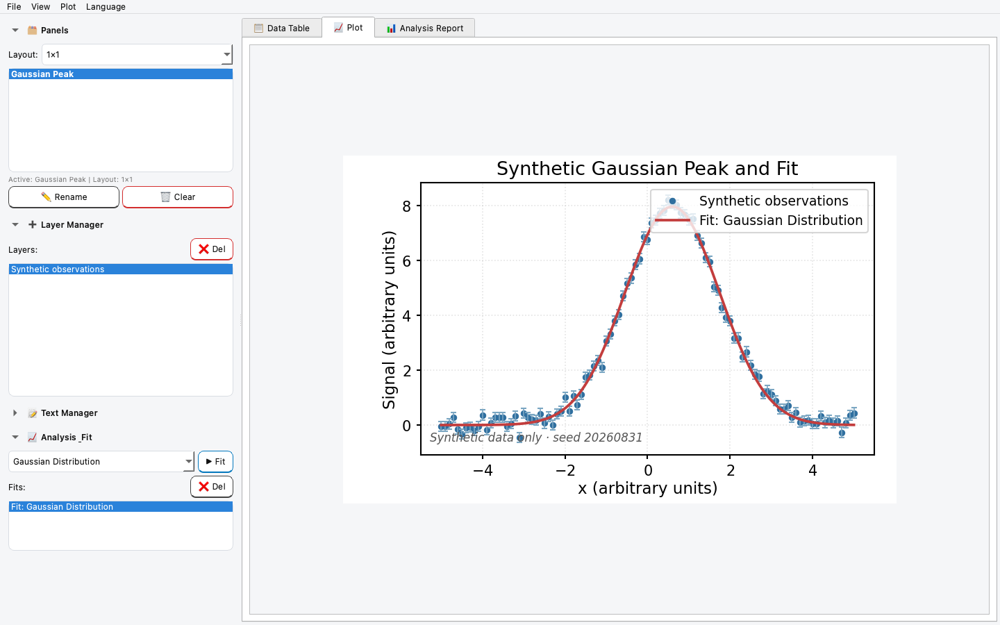
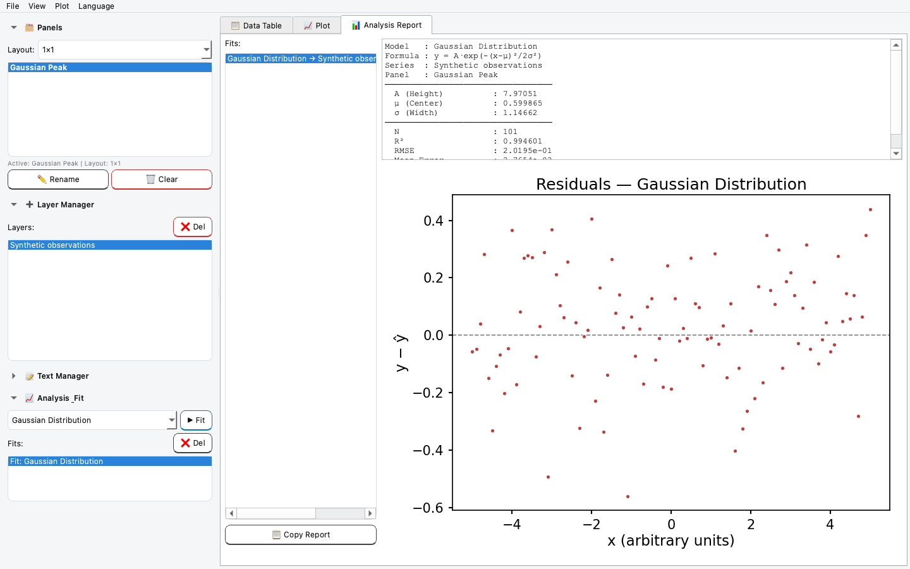

# NumeriPlot

**Scientific Plotting, Data Analysis and Curve Fitting**

NumeriPlot is a free and open-source desktop application for scientific
plotting, data processing, and curve fitting, designed primarily for students
and researchers.

> **Public Beta notice:** NumeriPlot 0.1.0 is available as a public beta
> pre-release. Interfaces, workflows, and the project-file format may still
> change. Independently verify numerical results before using them in research,
> teaching, or reports.

NumeriPlot is an independent academic software project maintained by Alptekin
YILDIZ. Istanbul Technical University is listed only as the developer's
academic affiliation; it is not the owner, publisher, sponsor, or support
provider of the project.

Türkçe özet için [README_TR.md](README_TR.md) dosyasına bakın.

## Current capabilities

- CSV and Excel data import with editable data tables
- Role-based X, Y, secondary-Y, X-error, and Y-error assignment
- Line, scatter, and grouped bar plots with configurable axes and legends
- Built-in curve-fitting models and fit-range controls
- Peak finding and common data-processing operations
- Project save/load with explicit schema validation
- PNG, PDF, SVG, table, Python script, and notebook export paths
- Turkish and English user interfaces

## Screenshots

The screenshots below were captured from the real NumeriPlot interface using
only the tracked, reproducible synthetic Gaussian example.





## Synthetic examples

The [`examples/`](examples/) directory contains three deterministic synthetic
CSV datasets and a ready-to-open NumeriPlot project:

- noisy linear data;
- a Gaussian peak with a saved Gaussian fit and residual statistics; and
- single-exponential saturation data.

No research, student, patient, or personal data is included. See
[`examples/README.md`](examples/README.md) for the formulas, parameters, and
fixed random seed. Regenerate the data and project from the repository root:

```bash
python3 examples/generate_examples.py
```

The example project can be opened with **File → Open Project…**. Maintainers
can reproduce the screenshots from that project with:

```bash
QT_QPA_PLATFORM=offscreen python3 examples/capture_screenshots.py
```

## Status and platforms

The first public beta binary is available from the
[official GitHub Releases page](https://github.com/alptekin-yildiz/NumeriPlot/releases/tag/v0.1.0)
as a pre-release for validation.

| Environment | 0.1.0 status |
| --- | --- |
| Apple Silicon, macOS 12 or newer | Public beta pre-release available; unsigned and not notarized |
| Intel Mac | No packaged build is planned for 0.1.0 |
| Windows and Linux | No packaged build or release validation is currently provided |
| Python 3.11 or newer | Source/development route; first release validation targets Apple Silicon macOS |

A successful source start on another platform does not mean that platform has
passed the NumeriPlot release checklist.

## Run from source

Python 3.11 or newer and internet access for the initial dependency download
are required. After the public repository is opened, clone it and run:

```bash
git clone https://github.com/alptekin-yildiz/NumeriPlot.git
cd NumeriPlot
bash setup.sh
source venv/bin/activate
python3 main.py
```

The setup script creates a local virtual environment and installs the declared
runtime dependencies from `requirements.txt`.

The automated release gate also requires the pinned development tools. Install
them into the same environment and run:

```bash
bash setup.sh --dev
source venv/bin/activate
bash release_check.sh
```

## Install the macOS ZIP

These instructions apply to the official `v0.1.0` pre-release assets on the
[NumeriPlot GitHub Releases page](https://github.com/alptekin-yildiz/NumeriPlot/releases/tag/v0.1.0):

1. Download `NumeriPlot_v0.1.0_macOS.zip` and its `.sha256` file only from the
   official NumeriPlot GitHub Release page.
2. In Terminal, calculate the downloaded ZIP's checksum:

   ```bash
   shasum -a 256 NumeriPlot_v0.1.0_macOS.zip
   ```

   Compare the complete result with the published checksum before opening the
   ZIP.
3. Double-click the ZIP and move `NumeriPlot.app` to `Applications`.
4. Control-click or right-click `NumeriPlot.app`, choose **Open**, and review
   the macOS warning before deciding whether to continue.

### Gatekeeper and the unsigned beta

The public beta build has no Apple Developer ID signature and is not
notarized. macOS therefore cannot identify the developer or confirm that Apple
has checked the application for malicious software.

If macOS still blocks the app after you try to open it, first confirm that it
came from the official release page and that its checksum matches. If you then
choose to proceed, open **System Settings → Privacy & Security**, find the
blocked-app message under **Security**, choose **Open Anyway**, and review the
confirmation dialog. Apple documents this exception process in
[Open a Mac app from an unknown developer](https://support.apple.com/guide/mac-help/open-a-mac-app-from-an-unknown-developer-mh40616/mac).

Do not bypass a warning that says the application is damaged or contains
malware. Do not use a quarantine-removal command as a routine installation
step.

## First workflow

1. Choose **File → Load Data…** and select a CSV, TXT, XLSX, or XLS file.
2. Review delimiter, encoding, header, skipped-row, and column-type choices in
   the import dialog, then import the table.
3. Open the **Data Table** tab. Assign column roles from a header's context
   menu, or apply a role template. A typical table uses one **X** column and
   one or more **Y Left** columns. A Y-only dataset can use automatic `1..n` X
   values.
4. Choose a plot type and select **Add Plot**. Use the series list and Plot
   settings to adjust style, axes, legend, layout, and labels.
5. To fit a curve, select a plotted series, choose a model under
   **Analysis & Fit**, select **Fit**, and review the parameters, goodness-of-fit
   values, and residuals.
6. Save the working project with **File → Save Project**. Export the figure,
   table, Python script, or notebook separately when needed.

## Data and project files

NumeriPlot imports `.csv`, `.txt`, `.xlsx`, and `.xls` data. Image exports use
PNG, PDF, or SVG; table exports use CSV or XLSX. Python and notebook exports
use `.py` and `.ipynb`.

A NumeriPlot project is a JSON file containing an embedded copy of the current
table together with plot series, fit results, text items, panel layout, and
display settings. Project JSON is an application format, not a stable public
data-exchange API. Keep the original data file and independent backups of
important projects, especially during the Public Beta.

Newly saved projects use the top-level `"schema_version": "1.0"` field.
Files with an unsupported or missing schema identifier are rejected instead of
being interpreted silently.

Loading a new data file replaces the current table and clears the current
plots, fits, and text items. Save the current project first if you may need it
again. Do not edit project JSON manually unless you understand the schema and
have a backup.

## Data, privacy, and logs

NumeriPlot processes data locally. It contains no telemetry, user tracking, or
automatic update checks. On macOS, diagnostic logs are written locally to:

```text
~/Library/Logs/NumeriPlot/numeriplot.log
```

Logs are not uploaded automatically. Before sharing a log or project file,
remove private research data, personal paths, credentials, and other sensitive
information.

## Scientific responsibility

NumeriPlot is provided without warranty. Fit parameters and other numerical
results depend on the data quality, model, initial values, constraints, and
selected range. Users are responsible for validating results independently.
The software is not validated for safety-critical, clinical, regulatory, or
certification calculations.

## Development process and AI assistance

NumeriPlot has been developed with substantial assistance from AI coding
agents, including OpenAI Codex, in implementation, testing, documentation, and
release preparation. The human maintainer directs the project, reviews and
accepts release-facing changes, and remains responsible for licensing,
releases, and scientific claims. AI assistance is not evidence of scientific
correctness; numerical results must still be independently verified.

NumeriPlot itself does not use AI services at runtime and does not send user
data to AI providers. Its local data and log behavior is described in
[Data, privacy, and logs](#data-privacy-and-logs).

## Citation

If NumeriPlot contributes to a publication, thesis, report, or teaching
material, please cite the software using the metadata in
[`CITATION.cff`](CITATION.cff). Citation is strongly appreciated but is not an
additional license condition.

## Contributing and support

See [`SUPPORT.md`](SUPPORT.md) for troubleshooting and
[`CONTRIBUTING.md`](CONTRIBUTING.md) before proposing a change. Once the public
repository is opened, normal questions and bug reports will use
[GitHub Issues](https://github.com/alptekin-yildiz/NumeriPlot/issues).
Security reports or reports containing sensitive data must follow
[`SECURITY.md`](SECURITY.md) instead of being posted publicly.

## License

NumeriPlot is licensed under the GNU General Public License v3.0 only. See
[`LICENSE`](LICENSE). Third-party components remain under their respective
licenses; see [`THIRD_PARTY_NOTICES.md`](THIRD_PARTY_NOTICES.md).
