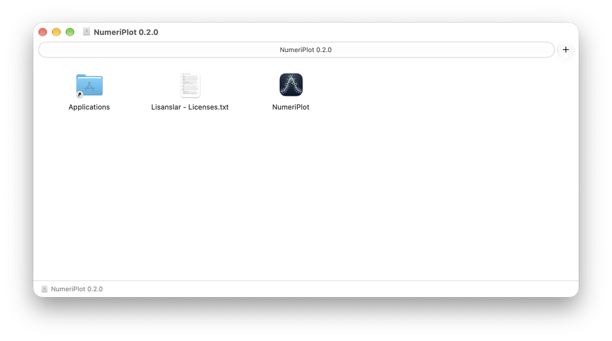
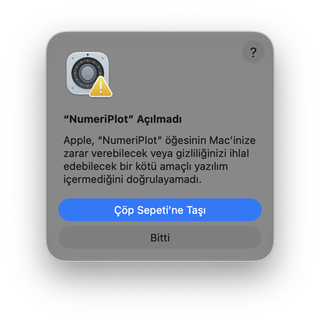
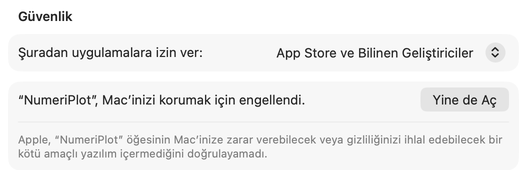
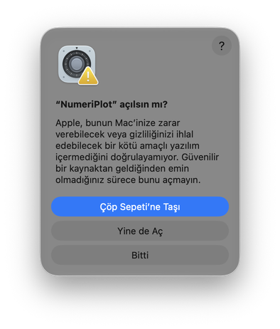
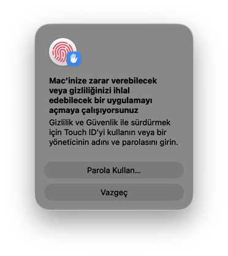

# NumeriPlot'u Mac'e kurma

Bu kılavuz NumeriPlot 0.2.0 içindir. Terminal, Python veya kod bilgisi
gerekmez: indirdiğiniz dosyadaki uygulamayı **Uygulamalar** klasörüne
sürükler ve diğer Mac uygulamaları gibi açarsınız. Kurulum yaklaşık beş dakika
sürer. [English](MACOS_INSTALL.md)

1. [Mac'iniz uygun mu?](#1-maciniz-uygun-mu)
2. [Dosyayı indirme](#2-dosyayı-indirme)
3. [Uygulamalar klasörüne kopyalama](#3-uygulamalar-klasörüne-kopyalama)
4. [Uygulamaya ilk açılışta izin verme](#4-uygulamaya-ilk-açılışta-izin-verme)
5. [Örnek projeyle deneme](#5-örnek-projeyle-deneme)
6. [Güncelleme](#6-güncelleme)
7. [Kaldırma](#7-kaldırma)
8. [Sorun giderme](#8-sorun-giderme)

## 1. Mac'iniz uygun mu?

Apple menüsünden () **Bu Mac Hakkında** penceresini açın:

- **Çip** satırında *Apple M1, M2, M3…* gibi bir ad görünmelidir.
- **macOS** sürümü 14 (Sonoma) veya daha yeni olmalıdır.

**İşlemci: Intel** yazıyorsa bu uygulama o Mac'te çalışmaz. Intel Mac,
Windows ve Linux kullanıcıları NumeriPlot'u kendi emekleriyle kaynak koddan
çalıştırabilir: [kaynak kurulum kılavuzu](SOURCE_INSTALL_TR.md).

Uygulama yalnızca macOS 27 yüklü bir Apple Silicon Mac'te denendi. macOS
14–26 desteklenir, ancak bu sürümlerde ayrıca denenmedi.

## 2. Dosyayı indirme

1. NumeriPlot'un
   [0.2.0 yayın sayfasını](https://github.com/alptekin-yildiz/NumeriPlot/releases/tag/v0.2.0)
   açın.
2. Sayfanın altındaki **Assets** bölümünden
   `NumeriPlot-0.2.0-macOS-AppleSilicon.dmg` dosyasını indirin (yaklaşık
   85 MB). Dosya **İndirilenler** klasörüne gelir.

NumeriPlot'u yalnızca bu resmî sayfadan indirin.

**İsteğe bağlı doğrulama:** Aynı sayfadan
`NumeriPlot-0.2.0-macOS-AppleSilicon.dmg.sha256` dosyasını da indirin. Terminal
uygulamasını açın ve şu iki komutu sırayla çalıştırın:

```bash
cd ~/Downloads
shasum -a 256 -c NumeriPlot-0.2.0-macOS-AppleSilicon.dmg.sha256
```

Sonuçta `OK` yazmalıdır. `FAILED` yazarsa dosyayı açmayın; yeniden indirin.

## 3. Uygulamalar klasörüne kopyalama

1. İndirilenler'deki `NumeriPlot-0.2.0-macOS-AppleSilicon.dmg` dosyasına çift
   tıklayın. **NumeriPlot 0.2.0** adlı bir pencere açılır. Pencerede
   **NumeriPlot** uygulaması, **Applications** (Uygulamalar) klasörünün kısayolu
   ve `Lisanslar - Licenses.txt` bulunur.

   

2. **NumeriPlot** simgesini sürükleyip **Applications** kısayolunun üzerine
   bırakın. Kopyalama birkaç saniye sürer.
3. Finder kenar çubuğunda **NumeriPlot 0.2.0** diskinin yanındaki ⏏ düğmesiyle
   diski çıkarın. İndirilen `.dmg` dosyasını artık silebilirsiniz.

Uygulamayı bu pencereden doğrudan açmayın; önce Uygulamalar klasörüne
kopyalayın.

## 4. Uygulamaya ilk açılışta izin verme

NumeriPlot ücretsizdir ve Apple'ın ücretli geliştirici imzasını taşımaz. Bu
yüzden macOS ilk açılışta uygulamayı durdurur ve bir kez sizin izninizi ister.

> Bu pencerelerde mavi renkli, öne çıkan düğme **Çöp Sepeti'ne Taşı**'dır.
> Ona ve Enter tuşuna basmayın; aşağıda yazan düğmeyi seçin.

1. Finder'da **Uygulamalar** klasörünü açın ve **NumeriPlot**'a çift tıklayın.
2. **“NumeriPlot” Açılmadı** penceresi çıkar. **Bitti** düğmesine basın.

   

3. Apple menüsünden () **Sistem Ayarları**'nı açın ve soldan
   **Gizlilik ve Güvenlik**'i seçin. Sağ tarafta **Güvenlik** bölümüne kadar
   aşağı kaydırın. **“NumeriPlot”, Mac’inizi korumak için engellendi.**
   satırının yanındaki **Yine de Aç** düğmesine basın.

   

4. **“NumeriPlot” açılsın mı?** penceresi gelir. **Yine de Aç**'ı seçin.

   

5. macOS, Touch ID'nizi veya **Parola Kullan…** ile Mac parolanızı ister.
   Onaylayın.

   

6. NumeriPlot birkaç saniye içinde açılır.

Bu adımlar her Mac'te yalnızca bir kez gerekir. Sonraki açılışlarda izin
istenmez. NumeriPlot'u Launchpad'den, Spotlight'tan (⌘ Boşluk, sonra
"NumeriPlot") veya Dock'tan da açabilirsiniz.

**Yine de Aç** düğmesi, açma denemesinden sonra yaklaşık bir saat görünür.
Düğmeyi göremiyorsanız 1. adımı tekrarlayın ve hemen Gizlilik ve Güvenlik'e
dönün. Apple bu yolu
[Bilinmeyen geliştiriciden gelen Mac uygulamasını açma](https://support.apple.com/tr-tr/guide/mac-help/mh40616/mac)
sayfasında anlatır.

> **Güvenlik:** Uygulamanın **hasarlı** olduğunu veya **kötü amaçlı yazılım**
> içerdiğini söyleyen bir uyarıyı atlamayın; dosyayı açmayın ve durumu
> bildirin. İnternette önerilen karantina kaldırma (`xattr`) komutlarını
> kullanmayın; yukarıdaki yol yeterlidir.

## 5. Örnek projeyle deneme

1. NumeriPlot'ta **Dosya → 🧪 Örnek Projeyi Aç**'ı seçin. Sentetik bir Gauss
   veri seti, grafiği ve kaydedilmiş fiti açılır.
2. Sağdaki sekmelerden grafiği ve **Analiz Raporu**'nu inceleyin.
3. Kendi kopyanızı kaydetmek için **Dosya → 📝 Projeyi Farklı Kaydet…** ile
   Belgeler gibi bir klasör seçin. Örnek dosyanın kendisi değişmez.
4. Grafiği **Dosya → 🖼 Görüntü Olarak Dışa Aktar…** ile PNG, PDF veya SVG
   olarak kaydedin.

Kendi verilerinizle başlamak için **Dosya → 📥 Veri Yükle…** yolunu izleyin.
Ayrıntılı kullanım için [görselli kılavuza](https://alptekin-yildiz.github.io/NumeriPlot/)
bakın.

## 6. Güncelleme

Yeni sürümün `.dmg` dosyasını indirin ve 3. bölümdeki gibi **Applications**
kısayoluna sürükleyin. macOS sorduğunda **Değiştir**'i seçin. Projeleriniz
uygulamanın içinde değil, kaydettiğiniz klasörlerde durduğu için etkilenmez.
Yeni sürüm için 4. bölümdeki izin bir kez daha istenebilir.

## 7. Kaldırma

**Uygulamalar** klasöründeki **NumeriPlot**'u Çöp Sepeti'ne taşıyın.
İsterseniz uygulamanın oluşturduğu iki klasörü de silebilirsiniz. Finder'da
**Git → Klasöre Git…** menüsünü açıp şunları yazın:

- `~/Library/Logs/NumeriPlot` (tanılama logları)
- `~/Library/Caches/NumeriPlot` (yazı tipi önbelleği)

Projeleriniz bu klasörlerde değildir; onlar kaydettiğiniz yerde kalır.

## 8. Sorun giderme

- **"Yine de Aç" düğmesi görünmüyor:** 4. bölümdeki notu izleyin. Kurumunuzun
  yönettiği bir Mac'te bu ayar kilitli olabilir; BT biriminize danışın.
- **Açılış uzun sürüyor:** NumeriPlot normalde birkaç saniyede açılır. Simgeye
  tekrar tekrar tıklamayın. Bir dakika içinde açılmazsa Dock'taki simgeye sağ
  tıklayıp **Çık**'ı seçin ve yeniden açın.
- **Yanlışlıkla "Çöp Sepeti'ne Taşı"ya bastım:** Çöp Sepeti'ni açın,
  NumeriPlot'a sağ tıklayıp **Geri Koy**'u seçin; ardından 4. bölümü
  yeniden izleyin.
- **Uygulama açılıp hemen kapanıyor:** Log dosyası
  `~/Library/Logs/NumeriPlot/numeriplot.log` konumundadır. Paylaşmadan önce
  kişisel yolları ve hassas içeriği temizleyin;
  [destek kılavuzunu](../SUPPORT_TR.md) izleyin.
- **Intel Mac veya macOS 13 ve öncesi:** Bu uygulama desteklenmez;
  [kaynak kurulum kılavuzuna](SOURCE_INSTALL_TR.md) bakın.

## Lisans ve kaynak kodu

NumeriPlot, GNU GPL v3 (yalnızca 3. sürüm) ile lisanslanan özgür bir yazılımdır.
Uygulama Qt (GNU LGPL v3), PyQt6 (GNU GPL v3) ve kendi lisanslarıyla dağıtılan
diğer açık kaynak bileşenleri içerir. Tam metinler uygulamada **Dosya →
ℹ️ Hakkında → Üçüncü Taraf Lisansları** altındadır. Kaynak arşivleri yayın
sayfasında yayımlanır; ayrıntılar [`THIRD_PARTY_NOTICES.md`](../THIRD_PARTY_NOTICES.md)
dosyasındadır.
